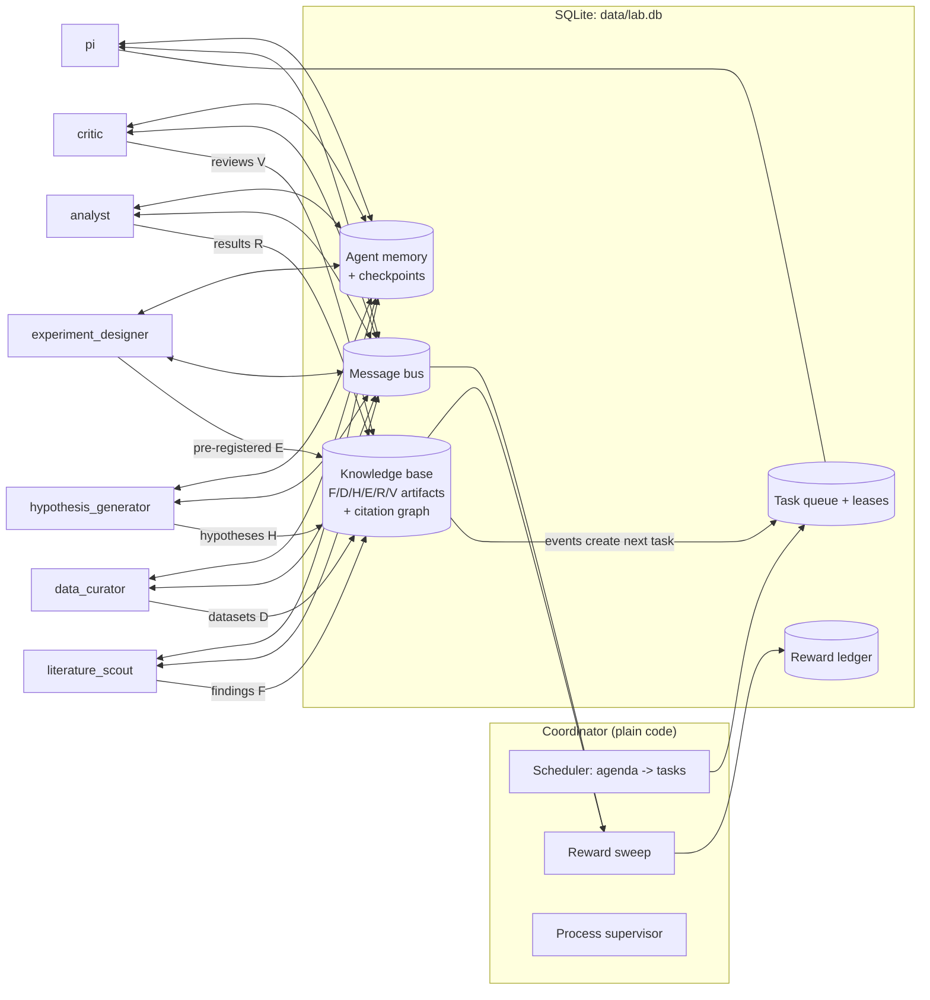

# Architecture

## Overview

Every agent is a separate OS process running the same loop with a different
role prompt and tool set. All shared state lives in one SQLite file, so the
whole system runs on a laptop with no servers. SQLite's WAL mode handles
concurrent readers and writers from several processes.

## Agents and their single responsibility

| Agent | Does | Produces | Key tools |
|---|---|---|---|
| `pi` | Reviews progress and scores, sets direction | tasks, broadcasts | `view_scores`, `create_task` |
| `literature_scout` | Reads literature on one agenda topic | **F**indings (claim + PMID + evidence level) | `search_literature` (Europe PMC) |
| `data_curator` | Finds, downloads, cleans public data | **D**atasets | `download_dataset` (allowlisted hosts), `run_analysis` |
| `hypothesis_generator` | Connects findings into testable ideas | **H**ypotheses with honest prior | `propose_hypothesis` |
| `experiment_designer` | Writes a falsifiable test plan, locks it | **E**xperiments (pre-registered, hashed) | `preregister_experiment` |
| `analyst` | Runs the locked plan exactly | **R**esults + script path | `run_analysis`, `record_result` |
| `critic` | Re-runs the script, checks plan vs. result | re**V**iews (replicated / valid / flawed) | `run_analysis`, `review` |

All agents also get: `read_inbox`, `send_message`, `rate_message`,
`search_knowledge`, `get_artifact`, `remember`, `recall`, `create_task`,
`complete_task`.

## Communication

Two channels, on purpose:

1. **Knowledge base (blackboard)** – the durable record. Artifacts are typed,
   numbered (`F12`, `H3`…) and must cite what they build on. The citation
   graph is how credit flows. Posting certain artifacts automatically queues
   the next step: `H` → design task, `E` → analysis task, `R` → review task,
   `V` → scoring. The science pipeline therefore keeps moving even if an
   agent forgets to hand off.
2. **Message bus** – for coordination: questions, data requests, warnings.
   Address an agent (`critic-1`), a role (`role:critic`) or everyone (`*`).
   `kind=request` messages that get a `reply` earn the replier credit;
   recipients rate messages 0–1.

## Memory and resuming interrupted work

Three layers:

| Layer | Stored in | Survives |
|---|---|---|
| **Checkpoint** – full conversation of the current task | `checkpoints` | crash, kill, reboot |
| **Tool-call log** keyed by `tool_use_id` | `tool_calls` | prevents repeating side effects on resume |
| **Long-term memory** – notes, lessons, pinned facts | `memories` (+ full-text index) | forever; injected into each new task's system prompt |

How a resume works:

1. A task is **claimed with a lease** (5 min, renewed every model turn).
2. After every model turn and every tool batch the conversation is saved.
3. If the process dies, the coordinator restarts it. On start the agent first
   asks for *tasks it already owns*, loads the checkpoint, and continues at
   the exact step. If the last saved message was a model turn with tool calls,
   it runs those tools – but any tool whose `tool_use_id` is already in the
   log returns the stored result instead of running again (no duplicate
   messages, artifacts or downloads).
4. If an agent is gone for good, the lease expires and another agent of the
   same role picks the task up from the same checkpoint.
5. Ctrl+C stops agents after their current step; ownership is kept, so
   `msagents run` later continues where it was.

A task that crashes 5 times is marked `failed` (`msagents retry-failed`
re-queues them).

## Rewards

Two channels, both written to an append-only ledger with dedupe keys so an
event is never paid twice.

### Testing reward (how good the tests after a hypothesis were)

Rewarding "successful" (positive) tests would teach agents to propose
trivial hypotheses and to p-hack. So the score is about **calibrated
forecasts and rigor**, judged by someone else:

| Who | Reward | Formula |
|---|---|---|
| experiment_designer | calibration of its forecast `p` | `1 − 4(p − outcome)²` → +1 confident & right, 0 coin flip, −3 confident & wrong |
| experiment_designer | inconclusive design | −0.25 |
| analyst | rigor, set by critic | replicated +1, valid +0.5, flawed −1; −0.1 per disclosed deviation |
| hypothesis_generator | honesty of its prior | `0.5 × calibration(prior, outcome)` |
| hypothesis_generator | discovery | if supported: `min(2, −log₂ p_designer)` (×0.5 if not replicated). Uses the *designer's* forecast so the author can't inflate it by understating their prior. |
| hypothesis_generator | clean refutation | +0.2 |

Only results the critic marks **replicated** or **valid** move calibration
and discovery scores. Pre-registration is enforced: the plan is hashed when
registered and `record_result` refuses if it changed.

### Collaboration reward

Paid only when *another* agent shows your work was useful:

| Signal | Reward |
|---|---|
| another agent cites your artifact | +0.3 |
| your finding/dataset fed a hypothesis that got tested | +0.2 |
| recipient rates your message `r` | `r − 0.3` (noise costs points) |
| you answer a `request` | +0.3 |
| critic completes a review | +0.3 (same for every verdict) |

Self-citation, self-rating and self-review earn nothing or are refused.

### How rewards are used

The agents are LLMs, not trained policies, so rewards act through context
and allocation rather than gradient updates:

- each new task's system prompt shows the agent its score and recent
  reward events, and agents write `lesson` memories after tasks;
- the `pi` agent sees the leaderboard and directs work;
- the ledger is the dataset you'd need later for fine-tuning or for
  choosing between prompt versions.

Known ways this can still be gamed (worth watching): agents citing each other
in rings, generous mutual ratings, the critic rubber-stamping. Mitigations to
add next: cap rewards per pair of agents, a second critic auditing a random
sample of reviews, and ratings weighted by the rater's own reliability.

## Data and code execution

- Literature: Europe PMC REST API (no key).
- Datasets: downloads only from an allowlist (NCBI/GEO, EBI, Zenodo,
  Figshare, GitHub raw, IMSGC, IEU OpenGWAS), max 200 MB, into `data/datasets/`.
- `run_analysis` runs agent-written Python in a separate interpreter with a
  timeout, working directory `data/`. **This is not a security sandbox.**
  Run the whole lab inside a container (see README) before giving agents
  real autonomy.

## Model calls

- `claude-opus-5-5`, adaptive thinking, effort per role in `config/agents.yaml`.
- Prompt caching on (`cache_control` auto) – system prompt, tools and history
  are reused every turn of a task. The system prompt is frozen per task (stored
  in the checkpoint) so the cached prefix stays stable, including across resumes.
- Server-side refusal fallback (`fallbacks: "default"`): biomedical topics can
  occasionally trip a safety classifier; the API then retries on Anthropic's
  recommended fallback model. A task that is still refused is marked `failed`.
- `--mock` replaces the model with a scripted offline backend for development.

## Extending

- **New role**: add it to `config/agents.yaml` (prompt + tools); give it a
  script in `mock.py` if you want it in offline runs.
- **New tool**: one decorated function in `tools.py`; add its name to a role.
- **Scaling up**: raise `count` for a role (e.g. 3 scouts). Leases make
  this safe. If SQLite contention appears, the tables map 1:1 to Postgres.
